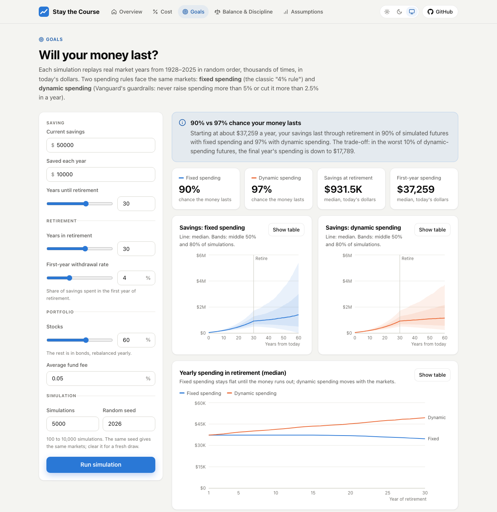
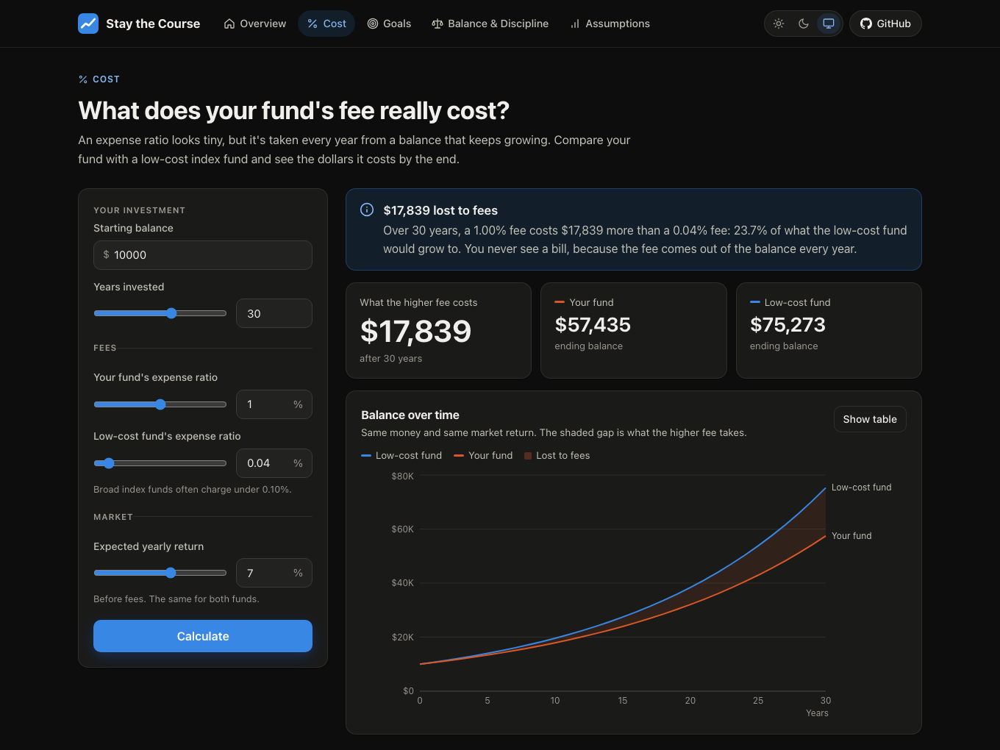

# Stay the Course

[](https://github.com/swejasonzhang/Stay-The-Course/actions/workflows/tests.yml)

A portfolio checkup built on Vanguard's four principles for investing success: **Goals, Balance, Cost and Discipline**. It shows what a fund's fee costs over decades, simulates whether retirement savings will last using 98 years of real market history, and checks whether a portfolio has drifted from its target, with a plan to fix it.

**Live:** https://stay-the-course-app.vercel.app (the first request after a quiet spell takes a few seconds while the API starts)



## Features

| Principle | Tool | How it works |
|---|---|---|
| Cost | Fee drag | Projects a balance year by year under two expense ratios. On $10,000 over 30 years at 7%, a 1% fee costs $17,839 more than a 0.04% index fund. |
| Goals | Retirement simulator | Monte Carlo over real (after-inflation) returns: each simulated year is a random historical year from 1928–2025, for 100 to 10,000 paths. Compares a fixed 4%-rule withdrawal with Vanguard's dynamic spending rule (yearly changes capped at +5% / −2.5%) on the same paths. |
| Balance & Discipline | Portfolio checkup | Current vs target mix, dollar-weighted fees, and a rebalancing plan that sends new money to underweight assets first and sells only if drift is still past the threshold. |
| — | Assumptions | The data behind the simulator: average and compounded returns, volatility, worst years, and stock–bond correlation. |

Every result opens with a one-sentence summary, and every chart has a table view. The site supports light and dark mode and works on phones.

## Architecture

```
Browser: React + TypeScript (Vite)       hosted on Vercel (built from GitHub on every push)
   │                                     and on S3 + CloudFront
   │  JSON over HTTPS
   ▼
API Gateway (HTTP API, throttled)
   ▼
AWS Lambda ─ Lambda Web Adapter ─ Spring Boot 4 on Java 21
                                    ├─ api/     controllers, request/response records, validation, error handling
                                    ├─ engine/  the finance math: plain Java, no Spring, unit-tested
                                    ├─ data/    1928–2025 returns, loaded once at startup
                                    └─ config/  CORS

S3 + Glue + Athena: SQL over the same returns data, for analysis
```

- **The math has no framework code.** Every formula is a plain Java method that tests call directly; controllers only translate HTTP into engine calls and back.
- **Two validation checkpoints.** A body that can't be read is a `400`. A body that breaks a rule (Bean Validation) is a `422` that names each field, and the UI shows each message next to its input.
- **Reproducible simulations.** Each request gets its own seeded `SplittableRandom`, so the same seed gives the same markets. Percentiles match Excel's `PERCENTILE.INC`.
- **Infrastructure as code.** One CloudFormation template defines the API, the function, the buckets, the CDN, the Athena workgroup and least-privilege IAM permissions; `infra/deploy.sh` builds and deploys it all.



## Tech stack

- **Backend:** Java 21, Spring Boot 4, Bean Validation, Jackson, Maven
- **Frontend:** React 19, TypeScript, Vite, Recharts
- **Cloud:** AWS Lambda, API Gateway, S3, CloudFront, Athena, Glue, IAM, CloudFormation; Vercel
- **Quality:** JUnit 6 and MockMvc (57 tests), Vitest (17 tests), oxlint, GitHub Actions

## Testing

The math is checked against independent answers, not just against itself: hand-calculated fee results, the compound-growth formula, Vanguard's published dynamic-spending example, and a simulation with the randomness removed that must match the fee calculator. API tests pin the HTTP contract: status codes, JSON shapes and validation messages. GitHub Actions runs every test, the linter and the production build on clean machines for every push.

## Running locally

Requires Java 21 and Node 20+.

```bash
# API on http://localhost:8080
cd backend && ./mvnw spring-boot:run

# Website on http://localhost:5173
cd frontend && npm install && npm run dev
```

Tests: `./mvnw test` in `backend/` and `npm test` in `frontend/`.

Call the API directly:

```bash
curl -X POST http://localhost:8080/fees -H 'Content-Type: application/json' \
  -d '{"initial": 10000, "annualReturn": 0.07, "fundFee": 0.01, "baselineFee": 0.0004, "years": 30}'
```

## Project structure

```
backend/    Spring Boot API: api/, engine/, data/, config/ (tests mirror them)
frontend/   React app: api/ (client and types), components/, features/ (one folder per page), lib/
data/       historical-returns.csv, the script that builds it, and Athena SQL
infra/      CloudFormation template, deploy and teardown scripts, Lambda start script
```

## Data

Annual returns on US stocks (S&P 500 with dividends), 10-year US Treasury bonds and inflation, 1928–2025, from Aswath Damodaran, NYU Stern School of Business. `data/scripts/extract_returns.py` rebuilds the CSV from the source spreadsheet and checks every year's inflation-adjusted return against the spreadsheet's own figures.

## Disclaimer

An educational project, not investment advice. Not affiliated with or endorsed by Vanguard.
